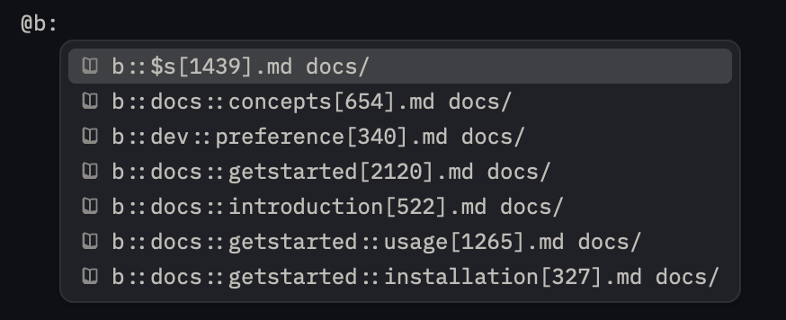
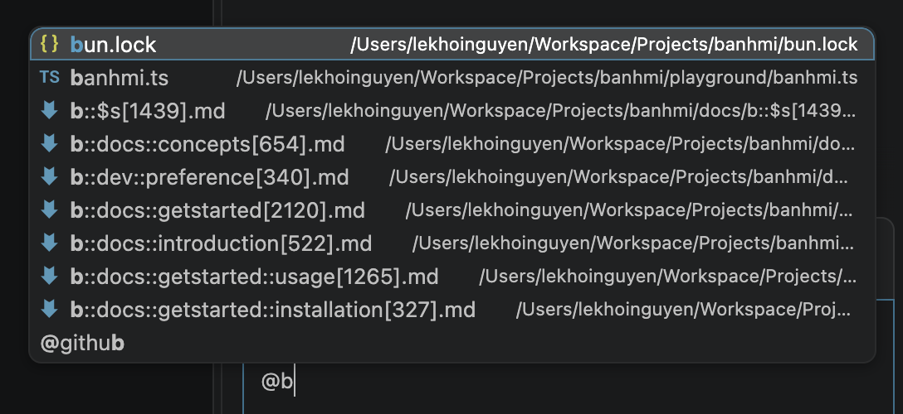

# 🍞 banhmi

"bánh mì" is a Vietnamese word that means "bread".

## Why

Like any breakthroughs, the abstraction level increases. In the AI revolution, implementation is abstracted. We believe the future is about orchestration, the communication of ideas.

However, the current context management practices using `SKILL.md` is not enough.
We feels there is the lack of:

- Domain management
- Context orchestration
- Parameterization

Therefore, we created "banh mi" to address these issues.

## How

Your Bánh Mì codebase will be generated files that:

- Match the Banh Mì query patterns.
- Typescript types & objects storing block content in the Banh Mi query patterns. Used in [Walker](https://walker.vstaffs.com/) projects.

### Page

Every `*.mi.ts` file must start with a `PAGE` block. Subsequent blocks will be added the page.

### Blocks

We provide 4 types of blocks to help you write your documentation:

- `FRONTMATTER` block: for writing frontmatter content.
- `TEXT` block: for writing text content.
- `CODE` block: for writing code content.
- `TABLE` block: for writing table content.

### Domain

Domain is a group of blocks that encapsulate an idea. Our recommendation is each domain should be a `PAGE` block.

### View

Domains using tree structure is not enough to represent complex domain relationships. Views allow you to tag each block and the compiler will aggregate these block into a page for each view. An example of this would be small, medium, and large context shortcuts - just like `llm-small.txt` or `llm.txt`.

## Usage

### Installation

```bash
# NPM
npm install banhmi

# PNPM
pnpm add banhmi

# Yarn
yarn add banhmi

# Bun
bun add banhmi
```

### Declaration

You need to create a file to declare your domains and views.
For example, you can create a file called `banhmi.ts` in your project root directory with the following content:

```typescript
import { getBanhMi } from "banhmi";

const domains = ["app", "app::post", "app::comment", "guide"] as const;
type Domain = (typeof domains)[number];
const views = ["$s", "$m", "$l"] as const;
type View = (typeof views)[number];

const banhmi = getBanhMi<Domain, View>({
  srcDir: import.meta.dir,
  outDir: "./docs",
});

export const { PAGE, TEXT, CODE, TABLE, FRONTMATTER, write } = banhmi;
export default banhmi;
```

### Example

```typescript
import { PAGE, TEXT } from "./banhmi";

PAGE("app", { title: "My App" });

TEXT(`
# Welcome to My App

This is the documentation for My App.
`);
```

## Demo

### Editors

We used `b::` prefix for our own `banhmi` context.
As you can see, the file names are the Bánh Mì query patterns.
A `b::docs::$s` is a view page for the blocks with the `$s` tag - our own `llm-small.txt`.




