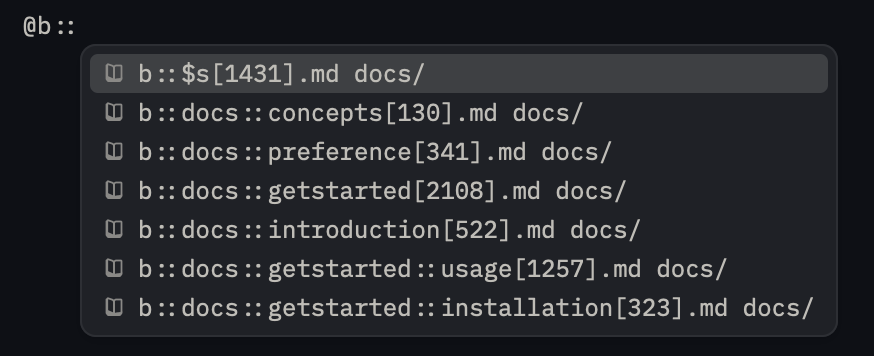

# 🍞 banhmi

"bánh mì" is a Vietnamese word that means "bread".

## Why

Like any breakthroughs, the abstraction level increases. For AI, implementation is abstracted, and we believe the future is about orchestration, the communication of ideas.

However, the current context management practices using 'SKILL.md' is not enough.
We feels there is the lack of:

- Domain management
- Type safety
- Parameterization

Therefore, we created a new abstraction layer called "banh mi" to address these issues.

## How

Your Bánh Mì codebase will be generated into files with names that match Bánh Mì's query patterns.

Bánh Mì for now has 2 main concepts:

### Domain

Domain is a group of blocks that encapsulate an idea.

### View

However, tree structure is not enough to represent complex ideas relationships. Views allow you to tag each block and the compiler will aggregate these block into a page for each view. An example of this would be small, medium, and large context shortcuts; just like llm-small.txt or llm.txt.

## Usage

You need to create a file to declare your domains and views.
For example, you can create a file called `banhmi.ts` in your project root directory with the following content:

```typescript
import { getBanhMi } from "banhmi";

const domains = ["app", "app::post", "app::comment", "guide"] as const;
type Domain = (typeof domains)[number];
const views = ["$s", "$m", "$l"] as const;
type View = (typeof views)[number];

const banhmi = getBanhMi<Domain, View>({
  srcDir: import.meta.dir,
  outDir: "./docs",
});

export const { PAGE, TEXT, CODE, TABLE, FRONTMATTER, write } = banhmi;
export default banhmi;
```

Then, you can use the blocks to start writing in any `*.mi.ts` file in your project.
Remember to use the `PAGE` block at the top of your file to declare the domain and metadata for the page.
You can use `TEXT`, `CODE`, `TABLE`, and `FRONTMATTER` blocks to add content to the page.

```typescript
import { PAGE, TEXT } from "./banhmi";

PAGE("app", { title: "My App" });

TEXT(`
# Welcome to My App

This is the documentation for My App.
`);
```

## Demo

### Zed



We used `b::` prefix. As you can see, the file names are the Bánh Mì query patterns. A `b::docs::$s` is a view page for the `docs` domain with the `s` tag.
